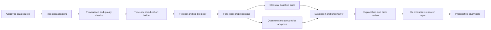

# QEDNET Early Disease Detection Product Specification

## Purpose and scope

QEDNET is a biomedical machine-learning research platform designed to develop and evaluate **pre-diagnosis risk prediction** methods, including hybrid quantum-classical candidates. Its purpose is to help research teams determine whether available patient history, measurements, or other biomedical data can identify elevated future risk early enough to support a defined follow-up action.

This specification is anchored only to the original problem statement and the early-detection workflow discussed with the user. It does not assume prior product wishlists are requirements.

The system is not clinically validated. Its current tabular benchmark classifiers do not establish early detection, clinical utility, quantum advantage, or improved outcomes. No output should be presented as a diagnosis, treatment recommendation, or substitute for a clinician. The research product can provide a path toward future clinical evaluation, but release into care requires a separate intended-use definition, independent evidence, human-factors evaluation, safety controls, and jurisdiction-specific review.

## Product users and primary workflow

**Primary users:** biomedical researchers, clinical investigators, data scientists, and quantum-computing researchers working with approved research data.

**Main workflow:**

1. Define a disease-risk question and intended population.
2. Specify the prediction moment, eligible inputs, outcome definition, and forecast horizon.
3. Import data with provenance and time/subject structure intact.
4. Build a cohort and run automated data-quality and leakage checks.
5. Register and lock a statistical analysis plan before comparing models.
6. Train classical baselines and quantum candidates on identical, leakage-safe partitions.
7. Evaluate predictive performance, calibration, subgroup performance, uncertainty, resource use, and robustness.
8. Review explanations and failure cases; export a report and all artifacts needed to reproduce the run.
9. If evidence supports progression, plan a prospective workflow study; do not silently promote a research model to clinical use.

## Non-negotiable early-detection study definition

The study designer must not allow a run to be called “early detection” until it records:

- **Condition and outcome:** disease/event definition, coding or adjudication rules, reference standard, date precision, and handling of uncertain diagnoses.
- **Population and setting:** inclusion/exclusion rules, care setting, age or other eligibility bounds where relevant, sites, and intended population.
- **Index time:** the exact time at which a prediction is considered available, such as a qualifying encounter or specimen collection.
- **Prediction horizon:** the prespecified future interval in which the event is predicted. There is no universal correct horizon; it must be clinically justified for the chosen condition and action.
- **Predictor window:** which observations before index time are allowed and how far back they may come from.
- **Outcome ascertainment and follow-up:** how the event is found, minimum follow-up, censoring rules, competing events, and loss-to-follow-up handling.
- **Decision context:** who would review a high-risk result, what action could follow, what happens after a low-confidence or unavailable prediction, and the comparator pathway.
- **Analysis plan:** primary metric, operating point, subgroup analyses, missing-data strategy, sample-size rationale, split strategy, and model-comparison procedure.

If the data only contain a contemporaneous disease label and no usable chronology, the platform must call the task **cross-sectional classification**, not early detection.

## Feature specification

### 1. Study and protocol workspace — required

- Guided protocol form for the disease, population, index time, predictor window, horizon, outcome/reference standard, exclusions, censoring, competing events, and comparator.
- Versioned study plan with author, timestamp, rationale, dataset eligibility, primary analysis, and changes made after registration.
- Lock confirmation before model comparison; any later change creates a new protocol version and is visible in the report.
- Study feasibility panel: participant count, outcome count, follow-up completeness, sites, repeated measures, missingness, and estimated precision/sample-size adequacy using an appropriate method. It must not rely on a universal “events per variable” shortcut.
- Clear status states: protocol incomplete, data not eligible, exploratory, internal evaluation, external evaluation, prospective evaluation, or not measured.

### 2. Biomedical data ingestion and lineage — required foundation

- Initial dependable path: tabular CSV/TSV with explicit schema, target/event fields, subject key, site key, timestamps, units, and source information.
- Validate types, ranges, duplicate records, missingness, unit compatibility, time ordering, repeated measurements, and target consistency before training.
- Preserve timestamps and subject/site keys for cohort construction and splits, but never pass identifiers to a model as predictors.
- Record data source, license/permissions, collection period, inclusion rules, transformation history, content fingerprint, and a de-identification/governance attestation.
- Show rejected rows and reasons without silently changing the cohort; provide a reviewable data-quality summary.
- Design adapters so an approved EHR integration can later map FHIR resources such as `Observation` into the internal schema. Do not claim an EHR integration until tested against a partner system and its profiles.
- Treat imaging, genomics, pathology, and high-frequency sensor streams as separate modality adapters with separate quality controls. The product should not claim to support them merely because they appear in the problem statement.

**Internal record contract:** subject pseudonym, site/cohort, event time, record time if different, clinical concept/code, value, unit, source/device, status, provenance, and permitted-use metadata. The contract needs explicit handling for corrections, delayed results, time zones, and duplicate events.

### 3. Time-aware cohort builder and leakage guard — required for early prediction

- Construct one or more prediction rows per subject at a documented index time.
- Restrict predictor values to information available at or before the index time. Distinguish measurement time from result-entry time when the data provide both.
- Apply a prespecified washout period when appropriate so existing/incipient diagnosed cases are not mislabeled as future cases.
- Define incident outcome windows, minimum follow-up, censoring, and competing risks explicitly.
- Detect and report subject overlap, site overlap, duplicate patients, post-index predictors, outcome-derived codes, repeated-measure leakage, and train/test time overlap.
- Split by patient/subject by default where records repeat. Support site-held-out and temporal holdout evaluation. Never silently fall back to random-row splitting when a requested unit-based split is impossible.
- Save split membership as protected stable identifiers or hashes so every comparison can be reproduced.

### 4. Modeling workbench — classical first, quantum as a challenger

- Establish a transparent baseline before advanced models: prevalence/constant baseline, regularized logistic regression, and a strong tree or kernel baseline appropriate to the data.
- Support horizon-specific risk estimation. When follow-up is censored or event timing matters, use time-to-event methods rather than forcing the data into a naive binary label. Support competing-risk methods when clinically meaningful events preclude the target event.
- Add modality-appropriate models only after an adapter and evaluation plan exist; do not concatenate incompatible modalities without a documented fusion method and missing-modality strategy.
- Include QSVM, variational quantum classifiers, and other explicitly implemented hybrid candidates behind an execution interface that identifies the actual simulator or device.
- Run all candidates on identical eligible participants, index times, predictor windows, outer splits, and evaluation code. Match preprocessing and tuning budgets; disclose parameter/resource differences.
- Keep tuning, feature selection, scaling, imputation, dimensionality reduction, calibration, and threshold selection inside training data at their respective nested levels.
- Store the full fitted preprocessing graph, model version, random seeds, configuration, software environment, and per-fold outputs.
- Provide a resource ledger for both families: fit and inference wall time, memory where available, parameter count, circuit depth/qubits/shots/device/provider for quantum runs, and failed/timed-out jobs.

### 5. Evaluation that answers an early-detection question

Report a declared primary metric and uncertainty, not a leaderboard score alone:

- **Discrimination:** ROC AUC and precision-recall AUC, interpreted against event prevalence and cohort design.
- **Operating performance:** sensitivity, specificity, PPV, NPV, and false alerts per a meaningful denominator at thresholds chosen without the test data.
- **Calibration:** calibration-in-the-large, calibration slope/curve, Brier score, and horizon-specific calibration where relevant. Fit any recalibration only on separate training/calibration data.
- **Time-to-event performance:** horizon-specific absolute-risk calibration and appropriate time-dependent discrimination/error metrics that account for censoring and competing risks.
- **Clinical utility:** decision-curve/net-benefit analysis at prespecified decision thresholds plus workload/alert burden. Statistical discrimination alone does not show that acting on predictions helps.
- **Early-warning value:** lead-time distribution among detected events, missed events, false alerts, and whether the prediction precedes normal clinical recognition. This must be compared with the actual current-care pathway.
- **Generalization:** internal resampling, temporal holdout, site-held-out, and external validation reported as distinct evidence levels.
- **Subgroups:** prespecified performance and calibration by clinically relevant population and data-source strata, with uncertainty and small-cell protections.
- **Robustness:** missingness and measurement changes, prevalence shift, site/device shift, label noise, and plausible data corruption.
- **Uncertainty/abstention:** coverage and error on covered cases; abstention cannot be presented as safety unless its workflow is evaluated.

Provide per-fold and cohort-level results, confidence intervals, event counts, denominators, threshold provenance, and protocol deviations. Do not infer a winner from overlapping standard deviations alone; specify the paired estimand and uncertainty method.

### 6. Explainability and review tools

- Show which input windows and fields were available at prediction time.
- Present feature contributions in original biomedical feature units where possible and identify when dimensionality reduction makes attribution approximate.
- Show explanations across folds and subgroups to reveal instability; explain that attribution is not causation.
- Provide case-level review of false positives, false negatives, missing-input behavior, and temporal data traces.
- For quantum models, provide circuit/feature-map description and simulator/device metadata; do not claim that circuit visualization is a clinical explanation.
- Keep explanations linked to the model artifact and data snapshot that generated them.

### 7. Research operations and governance

- User workspaces with role-based access suitable for research teams; separate access to identifiers from model-development features.
- Approved-data checks, consent/authorization record, data minimization, retention/deletion controls, audit trail, encryption, secret management, and incident response before sensitive data are accepted.
- Durable experiment queue, cancellation, retry semantics, checkpointing, resource limits, artifact versioning, and reproducible export.
- Reproducible environment lockfile/container, CI, dependency/security scans, backups and restore rehearsal, monitoring, and documented rollback before hosted release.
- Every page, report, API response, and export labels the evidence state and permitted use.

### 8. Real-time research shadow mode — only after a source is approved

- Receive events from a documented source adapter; preserve event time, ingestion time, units, device/source, and correction history.
- Apply freshness, range, completeness, duplicate, sequence, and out-of-order checks before any model call. Missing or stale required inputs produce an explicit “unable to evaluate” state.
- Trigger evaluation only on a protocol-defined event. Freeze the index time and eligible feature window so later-arriving data cannot change the past prediction silently.
- Begin in **silent shadow mode**: write a versioned research estimate and its provenance to an access-controlled audit store, but show no clinical recommendation or patient alert.
- Compare predictions with later outcomes and usual-care recognition; measure end-to-end latency, unavailable-result rate, lead time, false alerts, missed events, and reviewer workload.
- Provide an authorized research review queue with source timestamps, missing inputs, uncertainty, and correction/override annotation. Any reviewer action is collected as study data, not silently converted into a training label.
- Monitor feed health and input distribution. Alert on a broken or stale feed; do not automatically retrain on incoming observations.
- Define event delivery guarantees, idempotency, retries, deduplication, downtime behavior, and recovery before claiming real-time operation.

No live EHR/device source or approved longitudinal cohort is established by the current repository. Therefore end-to-end real-time performance is NOT MEASURED, and the system must not accept identifiable live health data until security, retention, authorization, and recovery controls are actually deployed.

### 9. Future clinical workflow — gated, not part of research release

If the user ultimately intends actual care use, define a specific intended use with clinical owners and regulators in the target jurisdiction. Then evaluate the locked system prospectively in the real workflow before any deployment decision. Measure clinician interaction, alert burden, overrides, automation bias, delays, failures, and patient outcomes where appropriate. Build the complete safety, quality, privacy, cybersecurity, human-factors, monitoring, and change-control program. Whether the software is regulated depends on its intended use and jurisdiction; a disclaimer alone does not decide this.

## Quantum-specific research protocol

Quantum is a testable research branch, not an assumed advantage. A credible comparison requires:

- A task and primary endpoint registered before looking at the held-out results.
- The same subjects, time windows, splits, predictor information, and preprocessing for classical and quantum models.
- Strong classical baselines, including classical kernel methods that approximate or reproduce relevant feature maps where applicable.
- Ablations separating the effect of the feature map, classical preprocessing, model capacity, and entanglement.
- Repeated seeds and independent cohort/site/time tests; uncertainty must be calculated at the independent unit, not by treating correlated rows/folds as independent patients.
- Separate ideal simulation, noisy simulation, and real-hardware results. Hardware reporting includes provider/device, connectivity, compilation, shots, queue/execution time, calibration state, errors, and mitigation.
- A prespecified definition of “useful”: clinically relevant improvement or comparable quality with a measured resource advantage. Report negative results.

A systematic review of QML for digital health found no consistent empirical trend supporting quantum utility and identified scarce realistic hardware/noisy-simulation evaluation. Therefore QEDNET should not promise quantum advantage; the feature is a fair, falsifiable comparison system.

## Architecture proposal

Keep the clinical data plane and research artifacts governed according to the data agreements. Do not upload identifiable data to a public demo or temporary filesystem service.

## Delivery plan and exit criteria

### Phase 1 — Specify one measurable use case

Select one disease and setting with a clinical/research partner, outcome adjudication path, usable longitudinal dataset, and permitted data access. Agree on index time, horizon, predictor availability, comparator, and action. Calculate data/sample-size feasibility using the intended model and validation design. If no suitable longitudinal data can be obtained, continue benchmark classification research but do not label it early detection.

**Exit:** a signed-off study protocol and data feasibility assessment; no model leaderboard is needed to pass this phase.

### Phase 2 — Build trusted temporal data and evaluation core

Implement subject/time-aware cohort creation, post-index leakage rejection, patient/site/time splits, nested fold-local transformations/tuning, censoring/competing-risk support as required, cross-fitted calibration, reproducibility artifacts, and data-quality review.

**Exit:** synthetic and real approved fixtures verify temporal cutoffs, group isolation, outcome windows, and full run reproduction. A locked evaluation dataset remains untouched during model development.

### Phase 3 — Establish baseline performance

Train prespecified statistical and classical baselines, conduct internal evaluation, and investigate calibration and errors. Decide whether the available sample supports model development or only evaluation of an existing model.

**Exit:** sample-size rationale, complete per-fold records, uncertainty, subgroup review, and a model-development report aligned to TRIPOD+AI; risk-of-bias/applicability review using PROBAST+AI.

### Phase 4 — Add and evaluate quantum candidates

Add simulator models first with truthful backend metadata, then noisy simulation and hardware only if access exists. Use the same splits and comparator budget. Test input encoding cost and resource scaling, not just predictive score.

**Exit:** predeclared quantum comparison report including negative results and measured hardware status; claim quantum utility only if the criteria defined in the protocol are met and independently reproduced.

### Phase 5 — External and prospective evaluation

Freeze a candidate model and evaluate it in independent sites/time periods. Then conduct a prospective silent-mode study, followed by a governed human-in-the-loop study only if prior evidence and approvals support it.

**Exit:** external evaluation with adequate precision, prospective workflow/safety evidence, operational monitoring, and the applicable regulatory and quality pathway resolved before any clinical deployment decision.

## Known unsolved problems and the least risky next move

| Unsolved problem | Why it blocks the goal | Pragmatic next move |
|---|---|---|
| No selected condition, prediction horizon, or intended action | “Early detection” cannot be measured without a specific target | Choose one use case with a clinical investigator before implementing more models |
| Existing datasets are cross-sectional benchmark data | They show status classification, not pre-diagnosis prediction | Obtain longitudinal, governed data or restrict claims to benchmark classification |
| Patient/time leakage and repeated measurements | Inflates apparent performance and corrupts generalization estimates | Make patient/time cohort keys first-class; assert train/test disjointness and cutoff rules |
| Sparse outcomes and uncertain labels | Small event counts and diagnosis delays cause unstable models and biased labels | Adjudicate outcome definitions; calculate required sample size/precision before training |
| Censoring and competing events | Naive fixed-label classification mislabels subjects without enough follow-up | Use survival/competing-risk methods where follow-up design requires them |
| Dataset shift and subgroup errors | A model can look good overall and fail in a site or population | External site/time evaluation, subgroup uncertainty, and shift monitoring |
| Thresholds and alert burden | AUC does not specify a useful or safe workflow | Prespecify thresholds and evaluate PPV, false alerts, workload, and net benefit |
| Quantum utility not established | Simulator wins can disappear with classical comparators, encoding cost, noise, and hardware limits | Keep quantum as a challenger; require fair resource-aware, independently reproducible evidence |
| Clinical deployment obligations are unknown | Intended use and jurisdiction determine required evidence and controls | Keep research-only until clinical owners and regulatory expertise define a pathway |

## Evidence and standards to use

- **TRIPOD+AI:** reporting of prediction-model development and evaluation: [BMJ statement](https://www.bmj.com/content/385/bmj-2023-078378).
- **PROBAST+AI:** appraisal of quality, risk of bias, and applicability: [BMJ tool paper](https://www.bmj.com/content/388/bmj-2024-082505).
- **DECIDE-AI:** reporting early-stage live clinical evaluation of AI decision support: [Nature Medicine consensus statement](https://www.nature.com/articles/s41591-022-01772-9).
- **External validation and sample size:** [BMJ external-validation guide](https://www.bmj.com/content/384/bmj-2023-074820) and [sample-size guidance](https://www.bmj.com/content/368/bmj.m441.full).
- **Quantum evidence:** [systematic review of QML for digital health](https://www.nature.com/articles/s41746-025-01597-z).
- **Clinical software scope:** [FDA CDS guidance](https://www.fda.gov/regulatory-information/search-fda-guidance-documents/clinical-decision-support-software) and current [FDA Good Machine Learning Practice principles](https://www.fda.gov/medical-devices/artificial-intelligence-enabled-medical-devices/good-machine-learning-practice-medical-device-development-guiding-principles). These are references for planning, not legal determinations for every jurisdiction.
- **Interoperability:** [HL7 FHIR R4 Observation](https://hl7.org/fhir/R4/observation.html) is a candidate source resource for measurements; implementation requires the actual source system’s profiles and terminology mappings.

## Product claims

Until the relevant gates are passed, describe QEDNET as a research platform for benchmarking classical and simulator-based quantum ML on supported biomedical datasets. Do not claim early detection, improved outcomes, clinical safety, production hardware compatibility, or quantum advantage based solely on cross-sectional benchmarks or simulator experiments.
