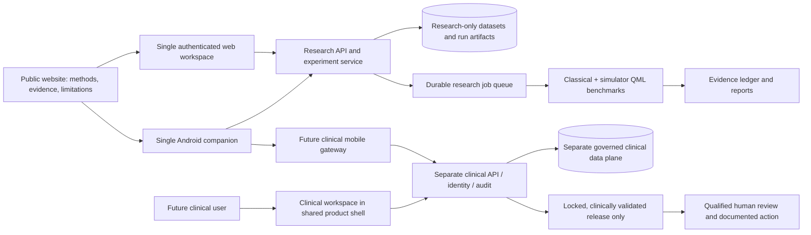

# QEDNET Target Product Specification

## Purpose

Design one coordinated, whole-body health research platform using hybrid quantum/classical ML, with a single public website, one authenticated web workspace, and one planned Android companion app. Women's health, including cycle and life-course research, is a first-class research area alongside health domains affecting men and mixed populations. The platform should support reproducible research on early-detection hypotheses and later, only after separate evidence and regulatory gates, a controlled clinical decision-support workflow.

The detailed whole-body scope, menstrual-health diary requirements, body-system research portfolio, and production gates are in [WHOLE_BODY_HEALTH_RESEARCH_PLAN.md](WHOLE_BODY_HEALTH_RESEARCH_PLAN.md). That document describes target work; it does not claim those features are implemented.

The research product and any future clinical function may share a brand and selected user-interface components, but must have separate authorization boundaries, data stores, model registries, audit trails, release controls, and safety cases. A role or feature flag alone is not an adequate clinical security boundary. Until the clinical gates are met, the clinical workspace remains unavailable.

This specification is a target design, not a claim that the listed features already work.

## What the current repository actually provides

| Capability | Current evidence in source | Status and limitation |
|---|---|---|
| Web research workspace | Next.js/React single-page dashboard with overview, datasets, training, prediction, explainability, benchmark, advantage, and report views. | Present in source; hosted research preview, not a validated clinical service. |
| Android application | No Android manifest, Gradle project, Kotlin/Java app source, or Flutter/Capacitor project was found in the repo scan. | Not present / NOT IMPLEMENTED. |
| Biomedical data | Breast-cancer adapter uses scikit-learn; heart disease, Parkinson's, and Pima diabetes adapters read local CSV files. | Tabular benchmark data only. Local files are not necessarily available in cloud deployment. |
| Imaging, genomics, EHR, wearable streams | No modality-specific ingestion, schema, or model pipeline for these types was found in the inspected adapters and API entry points. | NOT IMPLEMENTED. Add each modality only with approved datasets, format definitions, provenance, and validation. |
| Preprocessing | Imputation, scaling, feature selection, PCA, and optional training-only resampling are present in the tabular pipeline. | Present for supported tabular workflow; every experiment must still prove fold-local fit and transform. |
| Classical models | Logistic regression, random forest, XGBoost, RBF-SVM, and matched MLP are registered. | Present in source; actual performance depends on recorded benchmark runs. |
| Quantum models | QSVM, VQC, data re-uploading, and HybridQNN are registered. QSVM uses a feature-map fidelity kernel; VQC and re-upload use parameterized circuits; HybridQNN source contains a classical bottleneck, simulated quantum layer, and classical head. | Simulator-oriented research implementations. A source class is not evidence that a model was run in a reported benchmark. |
| Quantum hardware | The README describes NumPy statevector simulation and PennyLane reference simulation. | Real quantum hardware execution is NOT ESTABLISHED by this source review. Do not advertise hardware compatibility as verified until backend execution is tested and recorded. |
| Evaluation | Source includes AUROC, AUPRC, sensitivity, specificity, sensitivity at a specificity target, F1, MCC, Brier, ECE, calibration, bootstrap/statistics, and cross-validation engine. | Available in code; valid clinical interpretation still requires prespecified cohorts, splits, endpoints, and independent review. |
| Uncertainty and explainability | Source includes conformal/abstention and explainability code, including feature attribution and sensitivity/counterfactual paths. | Research tools; not proof of correctness, causality, or clinical safety. |
| Clinical workflow | No validated intended use, clinical partner workflow, prospective evidence, or regulated release process was established by this source review. | NOT IMPLEMENTED / NOT VALIDATED. |
| Hosted operations | Current Render deployment is described as filesystem-demo mode without durable experiment storage or integrated durable queue. | Preview only for non-sensitive research; not suitable for retaining health data or multi-user clinical work. |

### Meaning of “early detection”

Classification of a benchmark's already-labeled disease status does not establish early detection. Early detection requires a defined prediction time, an outcome/reference standard, a prediction horizon or lead time, representative longitudinal data, and a validation design that prevents future information from entering training. No current claim of early clinical detection is supported solely by the included benchmark datasets.

## Product surfaces and trust boundaries

- **Website:** public research/product information plus the authenticated web workspace. Public pages must clearly distinguish implemented, experimental, and unavailable features.
- **Android:** one client with research journaling, approved data import, and experiment/report viewing as the first scope. Clinical screens stay unavailable until a separate clinical service and release gate exist.
- **Unified brand, separated products:** a shared logo/navigation does not mean shared health records, credentials, roles, model artifacts, or training. Keep research and clinical APIs, storage, model release, and audit trails isolated.
- **No emergency channel:** neither the current QEDNET service nor consumer wearable sync is an emergency-monitoring system.

## Feature design: solve the real problems first

### Core research workflow

| User problem | Target feature | Required behavior / evidence |
|---|---|---|
| Biomedical files are heterogeneous and poorly documented. | Dataset registry and modality-specific ingestion. | Identify schema, target, units, cohort, source, license/permissions, collection site/time, missingness, and fingerprint; reject unsupported or unsafe files with specific errors. |
| Same-person/site/time information can leak across a split. | Patient-, site-, and time-aware split builder. | Select group/time keys before features are formed, exclude identifiers from predictors, save a split manifest, and fail when leakage checks find overlap. |
| High-dimensional data cannot be passed directly to a small circuit without a design choice. | Fold-local feature engineering and compression. | Fit imputation, normalization, feature selection, dimension reduction, and any resampling inside each training fold. Preserve a mapping to original variables and record information lost during compression. |
| Quantum results can look favorable under unfair comparisons. | Matched benchmark orchestrator. | Same participants, target, folds, preprocessing, tuning budget, evaluation code, and resource accounting for quantum and classical models. Run simple and strong classical baselines first. |
| A summary score hides instability and unsafe subgroups. | Evidence-first evaluation. | Report fold/site/time/subgroup results, class balance, AUROC/AUPRC, sensitivity/specificity, calibration, decision threshold basis, confidence intervals, uncertainty, failures, time and resource costs. |
| Users cannot reproduce a published number. | Immutable evidence ledger. | Store source/config hash, data fingerprint, split manifest, seed, package versions, model/circuit settings, raw fold predictions, logs, output artifacts, and exact command. Link every chart and certificate to that record. |
| Feature attributions can be mistaken for medical reasoning. | Explainability with stability and scope labels. | Show original-feature mapping, uncertainty and stability across folds; label association versus causation; retain counterexamples and no-explanation states. |
| Model confidence can be misleading under shift. | Calibration, conformal sets, abstention, and shift checks. | Fit calibration/thresholds only on designated training/calibration data, evaluate on untouched data, and return “insufficient evidence / out of supported domain” when needed. |

### Quantum research track

- Support QSVM, VQC, data re-uploading, and HybridQNN as experiment types only when their implementation and backend are explicitly identified in the run record.
- Keep simulator and hardware executions separate in user-facing labels. Record simulator/backend, qubits, circuit layers/depth, trainable parameters, encoding/feature map, shots, transpilation, queue time, fit/inference time, failures, and hardware calibration metadata where available.
- Add a provider interface only after a real provider and credential workflow are selected. Hardware execution must support job IDs, polling, cancellation where supported, timeout, retries without double-counting, and exportable circuit/run metadata.
- Do not promise quantum advantage. Require identical folds and feature inputs, strong classical kernels and feature maps, parameter/capacity comparisons, resource accounting, uncertainty, and independent reproduction.
- Treat quantum models as candidates, not defaults. Select a method only from prespecified validation evidence; if classical methods perform as well or better, report that plainly.

### Multimodal research expansion

1. **Structured tabular:** stabilize existing adapters, schema contracts, provenance, missingness, and leakage controls.
2. **Longitudinal/time series:** define event time, observation windows, prediction time, censoring, and future-outcome horizon. Use participant- and time-separated evaluation.
3. **Wearable/device signals:** add device metadata, units, sampling and quality checks, user consent, gaps/duplication handling, offline replay, and device-held-out tests.
4. **Medical imaging:** define DICOM or approved de-identified format support, image/series metadata, patient-level split, preprocessing/augmentation provenance, and modality-specific baselines. Do not infer image support from a tabular pipeline.
5. **Genomics/omics:** define assay/platform, genome build, normalization/batch effects, privacy/governance, feature-selection stability, and cohort-aware splits. Avoid claims from feature counts alone.
6. **EHR:** use an approved interface, terminology/unit mapping, time-aware feature construction, missingness/care-process analysis, access controls, and explicit data-use agreements.

Each modality is its own adapter and validation program. Do not merge them into a generic CSV-only “multimodal” claim.

### One website and Android app

- **Research workspace:** datasets/provenance, validation, experiment builder, queued runs, live-but-honest progress, benchmarks, explainability, uncertainty, reports, certificates, and reproducibility export.
- **Android research companion:** sign-in, consent and permission settings, optional journal/manual measurements, approved Health Connect import, sensor/session capture where a selected device supports it, offline-safe queue, run/report review, export/delete, and data-freshness indicators.
- **Public website:** problem statement, product scope, current capabilities, model cards, benchmark methods/results, simulator-versus-hardware status, limitations, roadmap, safety statement, and contact/governance pages.
- **Shared API contract:** versioned schemas for dataset, experiment, job, model, report, provenance, permissions, and error states. Web and Android call the same research API; future clinical calls use a separate service contract and authorization boundary.
- **Accessibility/reliability:** screen readers, keyboard navigation, clear units, localization, low-connectivity operation, explicit offline/stale states, and no sensitive health content in push or lock-screen previews.

### Clinical decision-support track (gated)

The clinical track is not an automatic mode switch from research. First select a specific condition, population, setting, user, decision point, output, and supported action with qualified clinical owners.

- Use representative, consented/governed clinical data and a clinically defined reference standard. Separate development, calibration, external validation, and prospective workflow evidence.
- Show evidence, source timestamps, intended population, limitations, uncertainty, and abstention. Require qualified human review; no autonomous diagnosis, prescription, or treatment change.
- Define alert ownership, acknowledgement, escalation, quiet/downtime behavior, false-alarm burden, missed-event risk, and alternative standard-care pathway with the clinical partner.
- Keep clinical identity, data storage, API, model registry, audit trail, monitoring, change control, incident response, and deployment isolated from the research service.
- Complete privacy/security, quality-system, human-factors, independent clinical validation, market-specific regulatory review, and post-release monitoring before clinical deployment.

## Product tiers

### Build first — credible research MVP

- Tabular biomedical ingestion with provenance, schema and label checks.
- Patient/site/time-safe splits and fold-local preprocessing.
- Fair classical-versus-simulator-QML evaluation with recorded negative results.
- Dataset cards, raw fold outputs, evidence-linked reports, and reproducibility bundles.
- Research website/workspace hardening, durable jobs/storage before multi-user or retained uploads.
- Android shell only after the versioned API, consent, privacy, deletion, and offline semantics are defined; start with non-clinical research workflows.

### Advanced research — after foundation

- Time-series, wearable, imaging, genomics, and EHR adapters one by one.
- External-site and temporal validation, calibration, conformal prediction, subgroup and shift analysis.
- Federated evaluation, edge inference research, hardware-in-loop replay, and real quantum provider support when available.
- Digital physiology/twin experiments only as explicitly speculative research with prospective validation requirements.

### Clinical product — only after gates

- Clinician-facing workflow integration, validated alerts, model release control, clinical audit and monitoring, and separately governed Android/web experiences.
- No clinical use of current public benchmark-trained artifacts or Render preview.

## Definition of done for “end to end”

A feature is end-to-end only when a permitted data source can enter through the documented web/Android path, pass schema/consent/security/quality checks, flow through versioned preprocessing and model execution, create durable job/result records, show honest uncertainty and source freshness, be exported/deleted, and be reproduced from the recorded provenance. For clinical features, add independent representative validation, human-factors evidence, safety controls, regulatory review, production recovery, and signed release approval.

## Decisions still open

- Initial intended early-detection use case and target population; these determine the labels, horizon, data, and clinical partner needed.
- Initial modalities and actual permitted data sources; imaging, genomics, EHR, and wearable access are not assumed.
- Android device/wearable models and whether data is manually entered, imported, or streamed.
- Real quantum hardware provider and access credentials; hardware execution is not established.
- Hosting/storage budget and retention policy; free demo hosting is not production storage for health data.
- Whether the website/app should expose only research initially (recommended) or include a disabled clinical entry point until gates are met.

Do not invent completion dates or acceptance thresholds until these decisions and owners exist.
